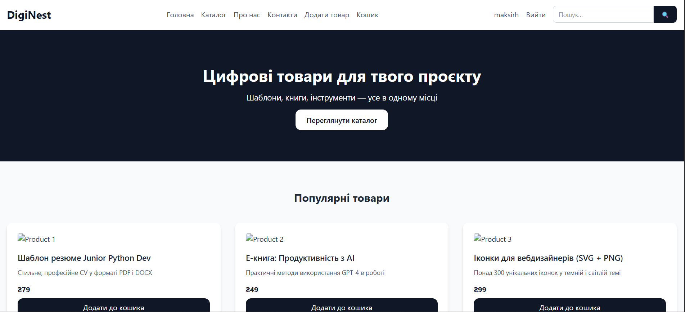

# DigiNest

Marketplace for digital goods (templates, e-books, icons, etc.) built with Django: users list products with downloadable files, buy them via **Stripe Checkout**, and download purchases after a verified webhook.

> **Demo:** TODO — add a live demo link (or remove this line)



> **More screenshots:** TODO — catalog, product page, basket/checkout

## Features

- Product catalog with search by name and pagination
- Product page with view counter; top-3 most viewed products on the home page
- Sellers can add, edit and delete their own products (image + downloadable file)
- Seller profile pages
- Basket (one per user) with total price
- **Stripe Checkout** payment (UAH) and a **Stripe webhook** (`/webhook/stripe/`) with signature verification that records purchases and clears the basket
- Purchased file download endpoint (served only to the buyer)
- Registration, login/logout, profile with avatar and phone number
- Tailwind CSS 4 styling (local build, no CDN)
- Experimental: `products/ai_utils.py` wraps a local GGUF Llama model via `llama-cpp-python` (not wired into views yet)

## Tech stack

- Python 3.12, Django 5.2
- Stripe (Checkout + webhooks), django-environ
- SQLite (default)
- Tailwind CSS 4 + PostCSS (npm)
- llama-cpp-python (experimental)

## Project structure

```
store/      project settings and root URLs (incl. Stripe webhook)
products/   products, types, basket, purchases, checkout, downloads
users/      profiles, registration, seller pages
static/     Tailwind source and compiled CSS
docs/       screenshots
```

## Running locally

```bash
git clone https://github.com/maksirh/DigiNest.git
cd DigiNest
python -m venv venv
source venv/bin/activate            # Windows: venv\Scripts\activate

pip install django==5.2.3 django-environ stripe pillow
# (requirements.txt currently lists only Django and its dependencies)
```

Create `.env` next to `manage.py`:

```env
STRIPE_SECRET_KEY=sk_test_...
STRIPE_PUBLISHABLE_KEY=pk_test_...
STRIPE_WEBHOOK_SECRET=whsec_...
```

```bash
python manage.py makemigrations users products
python manage.py migrate
python manage.py createsuperuser

npm install
npm run build        # Tailwind in watch mode (separate terminal)

python manage.py runserver
```

Forward Stripe webhooks to the local server with the Stripe CLI:

```bash
stripe listen --forward-to localhost:8000/webhook/stripe/
```

## TODO

- [ ] Screenshots / demo link
- [ ] Complete `requirements.txt`, add `.env.example` and `.gitignore`
- [ ] Add missing templates `products/my_files.html` and `users/profile_edit.html`
- [ ] Wire up (or remove) the local LLM search
- [ ] Automated tests
